
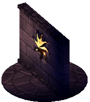
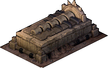
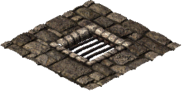

# Revenant

Set of tools created to interact with Revenant content (RPG game by Cinematix studios, released in
1999 by the publisher Eidos Interactive).

## Before you start

All scripts in this repository are supposed to be launched using Python 3.

Basic setup:

```shell
pip install uv
git clone git@github.com:IgorZyktin/Revenant.git
cd Revenant
uv sync
```

## Automap processing

When you play Revenant, that small map in lower right corner of the screen is called an automap.
Automap is built out of small *.bmp files located in the module file.

You may need to unpack your module first, for example "Ahkuilon.rvm". It is just a zip file, you can
rename it to "Ahkuilon.zip" and then unpack.

How to stitch them:

```shell
uv run python automaps.py --source-folder "C:\Games\Revenant\Modules\Ahkuilon\Automaps"
```

Already processed automaps:

* [Outdoor](./automaps/Automaps_00.png)
* [Castle](./automaps/Automaps_02.png)
* [Ancient tower](./automaps/Automaps_03.png)
* [Arakna Island](./automaps/Automaps_04.png)
* [City](./automaps/Automaps_05.png)
* [Caves 1](./automaps/Automaps_30.png)
* [Caves 2](./automaps/Automaps_31.png)
* [Caves 3](./automaps/Automaps_32.png)
* [Caves 4](./automaps/Automaps_36.png)
* [Altar](./automaps/Automaps_37.png)
* [Caves 5](./automaps/Automaps_39.png)
* [Catacombs 1](./automaps/Automaps_41.png)
* [Catacombs 2](./automaps/Automaps_44.png)
* [Catacombs 3](./automaps/Automaps_45.png)
* [Catacombs 4](./automaps/Automaps_46.png)
* [Catacombs 5](./automaps/Automaps_48.png)
* [Catacombs 6](./automaps/Automaps_49.png)
* [Other world 1](./automaps/Automaps_51.png)
* [Other world 2](./automaps/Automaps_52.png)
* [Other world 3](./automaps/Automaps_53.png)
* [Other world 4](./automaps/Automaps_54.png)
* [Other world 5](./automaps/Automaps_55.png)
* [Other world 6](./automaps/Automaps_56.png)
* [Other world 7](./automaps/Automaps_57.png)
* [Other world 8](./automaps/Automaps_58.png)
* [Demo outdoor](./automaps/demo_10.png)
* [Demo underground](./automaps/demo_30.png)

## I2D image processing

Tool that converts *.i2d files into images. One-frame files gets turned into png, 
multi-frame outputs as gifs.






Convert single file:

```shell
uv run python i2d_to_image.py "C:\Games\Revenant\imagery\Imagery\Equip\AoRogoss.I2D"
```

Convert whole catalog recursively into new folder:

```shell
uv run python i2d_to_image.py "C:\Games\Revenant\imagery\Imagery" -r -o images
```

Show structure without saving:

```shell
uv run python i2d_to_image.py --info AoRogoss.I2D
```
